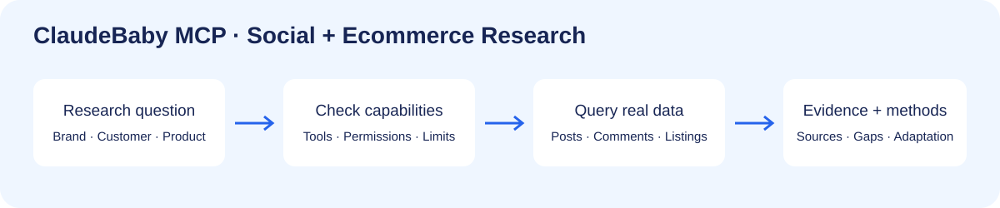

# ClaudeBaby MCP · 社媒研究与电商数据接入

[English](README.en.md) · [接入指南](docs/getting-started.md) · [Codex 插件](plugins/claudebaby-research/README.md) · [平台与能力](docs/platforms.md) · [官网](https://claudebaby.cn/)

ClaudeBaby 是面向 AI Agent 的远程 MCP 数据服务。通过一个 HTTPS 连接，按实际开放能力查询社媒帖子、评论及电商商品，用于品牌研究、需求洞察、竞品分析和采购候选比较。

这个仓库提供公开接入配置、研究示例和故障说明。远程服务按账户权限和积分提供数据；使用服务无需下载或启动服务端。

## 先跑通一次查询

1. [注册 ClaudeBaby](https://claudebaby.cn/console/register?ref=M8YYGRN4)，在控制台获取自己的 API Key；已有用户沿用当前账户。
2. 添加远程 MCP：`https://claudebaby.cn/mcp`，传输为 Streamable HTTP；鉴权使用 `Authorization: Bearer YOUR_API_KEY` 请求头。
3. 让 Agent 先读取工具目录，再查询 `business_capabilities` 和 `source_support`，确认目标平台和能力。
4. 选一个平台做最小实际查询，核对原帖或商品链接、日期、字段和错误后，再扩大样本。

Key 只放在个人客户端的凭证配置中。完整步骤和 [Codex](examples/codex.config.toml)、[Cursor](examples/cursor.mcp.example.json) 配置见 [接入指南](docs/getting-started.md)；不同客户端可能给工具名加前缀，以当次目录为准。

也可以从本仓库的 Codex 插件市场安装 **ClaudeBaby Research**：在 Codex CLI 执行 `codex plugin marketplace add lingling1989r/claudebaby-mcp`，再到 Plugins 目录安装。插件配置不包含任何用户 Key；官方公共插件目录仍需单独通过 OpenAI 的连接扫描与审核，当前固定 API Key 认证方式尚未通过该入口的连接限制。详见 [Codex 插件说明](plugins/claudebaby-research/README.md)。

## 能用来研究什么

| 你想解决的问题 | 工作方式 | 教程 |
| --- | --- | --- |
| Reddit 用户为什么讨论或吐槽一个品牌？ | 找原帖、阅读真实评论、区分作者自述与推断 | [Reddit 品牌与评论研究](docs/reddit-brand-research.md) |
| 1688 的便宜 ESP32 是开发板还是完整套件？ | 核对 SKU、BOM、MOQ、阶梯价，再与海外商品匹配 | [1688 与海外套件比价](docs/1688-kit-comparison.md) |
| 小红书和 YouTube 有哪些值得研究的品牌内容？ | 分平台检索，保留来源和日期，拆解方法与适用条件 | [社媒案例研究](docs/social-case-research.md) |
| 如何让 WorkBuddy 调用这些数据？ | 远程 MCP 加用户自填 Key，先验证工具和最小查询 | [WorkBuddy 接入](docs/workbuddy.md) |

研究模板用于引导 Agent 的工作流程，不代表服务自动完成报告、自动发帖或替用户采购。[可直接使用的研究请求](examples/research-prompts.md)覆盖 B2B 获客、社区需求、竞品差评和供应链候选比较。

## 当前支持情况怎么判断

不要只凭 README 的平台列表。先看实时 [MCP 发现文档](https://claudebaby.cn/.well-known/mcp.json)，再看账户实际 `tools/list` 和业务查询结果。

2026-10-13 的公开发现文档将 Reddit、X、小红书、YouTube、抖音、TikTok、1688、Amazon、Shopee、Temu、TikTok Shop 和 Walmart 标为 live。权限、具体字段和返回数据仍需查询核实。B站、LinkedIn、Instagram 等在该快照中是 planned；Facebook 在能力查询中为 unsupported。

业务目录当前提供 `business_capabilities`、`source_support` 和 `product_research`。`market_research`、统一 `content_search`、`topic_monitor` 仍是 planned；社媒研究使用实际可用的平台工具。详情见 [能力与验证边界](docs/platforms.md)。

## 示例与费用

[能力检查样本](examples/capability-check.json)是一次真实支持查询的脱敏结果，仅证明能力声明，不代表完整市场数据查询成功。研究数据不预先伪造，示例请求的结果取决于账户、工具和数据覆盖。

服务查询可能消耗积分，执行前核对控制台与 [价目表](https://claudebaby.cn/pricing.json)。公开文档与配置模板采用 MIT 许可；远程服务及第三方原帖媒体不因此变为免费或获得再发布授权。

## 报告和案例库

如果想把来源、图片、方法和品牌应用建议整理成 Excel，可搭配独立的 [social-case-to-excel Skill](https://github.com/lingling1989r/social-case-to-excel)。数据连接和报告整理是两层工作；报告里的互动、作者自述效果、研究推断和商业结果应分开写。

## 反馈和后续更新

[提交使用问题](https://github.com/lingling1989r/claudebaby-mcp/issues/new/choose)，附上客户端版本、平台、工具名和脱敏错误，帮助我们补充可复现教程。若这些配置和研究方法对你有用，欢迎 ⭐ Star 保存项目，方便回来查看更新。

常见问题见 [FAQ](docs/faq.md)。文档更新：2026-10-13。
